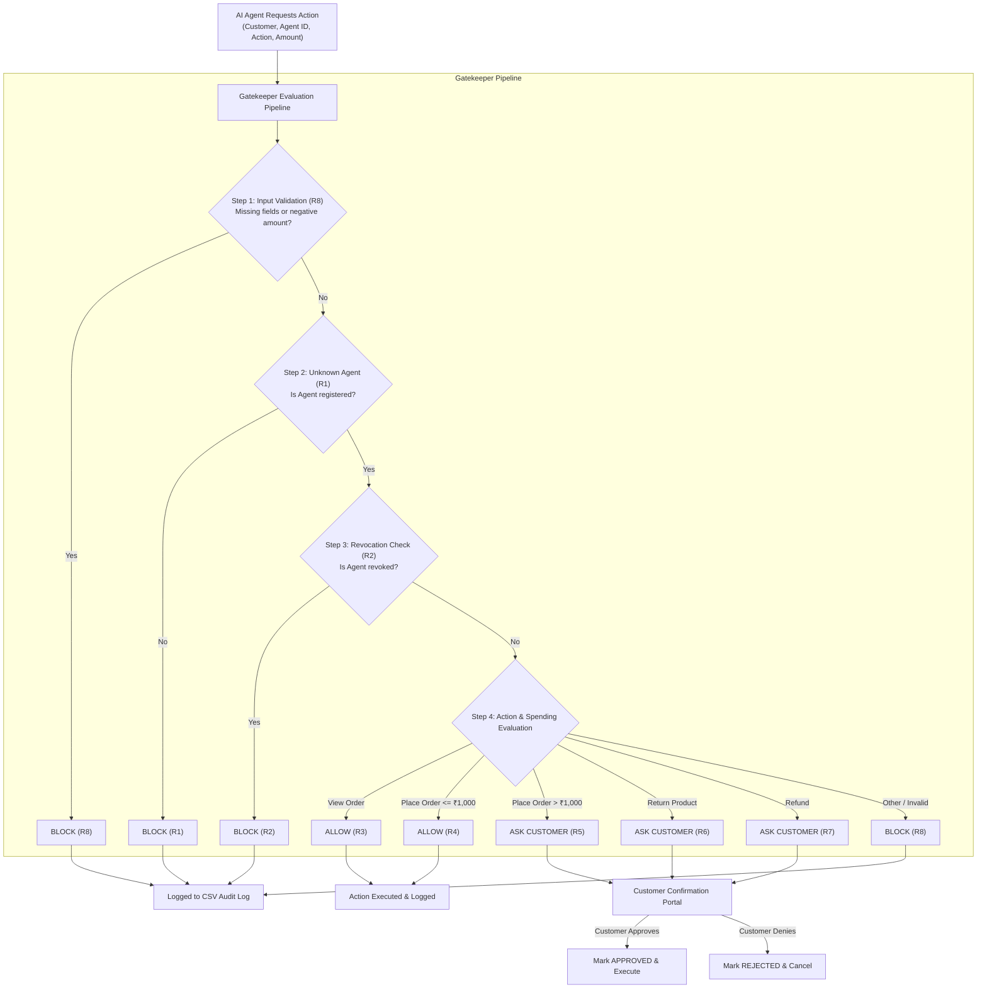

# Amazon Agent Gatekeeper
### An AI Agent Authorization and Access Control System (Academic Simulation Prototype)

---

## 🎓 Academic Submission Details
- **Student Name:** `[ENTER YOUR NAME]`
- **Enrolment Number:** `[ENTER YOUR ENROLMENT NUMBER]`
- **Company:** Amazon (Academic Simulation Prototype)
- **Project:** Agent Gatekeeper
- **Academic Year / Semester:** 2026

---

> [!IMPORTANT]
> **Academic Simulation Disclaimer:**  
> This project is a university prototype built exclusively for academic, research, and educational purposes.  
> It is **NOT** connected to real Amazon production systems, does **NOT** access real customer credentials, and does **NOT** place real purchases or execute actual financial transactions. All rules, thresholds (e.g., the ₹1,000 threshold), and agent workflows represent academic simulations designed to demonstrate zero-trust AI security principles.

---

## 1. Introduction
With the rapid emergence of autonomous Large Language Model (LLM) agents, AI assistants are increasingly empowered to invoke software tools and APIs on behalf of users. While this unlocks unprecedented automation in e-commerce, it introduces severe vulnerabilities: hallucinated actions, prompt injection exploits, and runaway financial charges.

**Amazon Agent Gatekeeper** is an external, deterministic access control and authorization middleware designed to govern all actions initiated by AI agents in an online retail environment.

---

## 2. Problem Statement
Autonomous AI agents cannot be trusted to self-regulate their own security permissions:
1. **Probabilistic Unreliability:** An LLM might hallucinate that an action is safe or misunderstand ambiguous user phrasing.
2. **The Confused Deputy Vulnerability:** Adversarial prompt injection (e.g., hidden instructions in product reviews or user chat) can trick an agent into executing destructive actions like unauthorized cancellations or refunds.
3. **Absence of Human Oversight:** Unchecked automated spending creates catastrophic financial risk for customers and retailers.

---

## 3. Project Objectives
1. **Deterministic Access Control:** Enforce a strict, prioritized 8-rule authorization engine that intercepts every AI agent action.
2. **Three-Tier Decision Framework:** Evaluate every transaction into one of three unequivocal decisions:
   - `ALLOW` (Auto-execute safe routine requests)
   - `ASK CUSTOMER` (Human-in-the-Loop approval gate)
   - `BLOCK` (Prohibit unauthorized or invalid requests)
3. **Identity & Lifecycle Management:** Maintain a persistent registry of registered, active, and revoked AI agents with cryptographic timestamps.
4. **Human-in-the-Loop (HITL) Workflow:** Ensure high-impact actions (purchases > ₹1,000, returns, refunds) cannot execute without explicit customer confirmation.
5. **Immutable Compliance Auditing:** Persistently log every evaluation and confirmation decision in a structured CSV audit log for forensics.
6. **Automated Verification:** Provide a comprehensive automated test suite (Pytest & in-app GUI testing) verifying 100% test coverage.

---

## 4. Business Case & Value Proposition
- **Consumer Trust & Safety:** Customers know AI assistants operate within strict financial sandboxes.
- **Financial Risk Containment:** Routine low-value purchases (&le; ₹1,000) proceed seamlessly, while high-value spending is safeguarded.
- **Emergency Kill Switch:** Administrators can instantly revoke compromised agents, preventing all further actions.
- **Regulatory Readiness:** Provides forensic accountability aligned with emerging AI governance regulations.

---

## 5. Technology Stack
- **Programming Language:** Python 3.10+ (tested on Python 3.14)
- **Web Application Framework:** Streamlit (v1.30+)
- **Data Analytics & Logging:** Pandas
- **Persistent Storage:**
  - JSON for Agent Registry (`data/agents.json`)
  - CSV for Immutable Audit Logs (`data/audit_log.csv`)
- **Automated Testing:** Pytest

---

## 6. System Architecture



---

## 7. Prioritized Authorization Rules Table

| Rule ID | Rule Name | Evaluated Condition | Decision | Category | Rationale |
| :--- | :--- | :--- | :--- | :--- | :--- |
| **R1** | **UNKNOWN AGENT** | Agent ID not in persistent registry | `BLOCK` | Identity | Zero-trust authentication prevents rogue agents. |
| **R2** | **REVOKED AGENT** | Agent status is marked `REVOKED` | `BLOCK` | Security | Immediate kill-switch prevents compromised agents. |
| **R3** | **VIEW ORDER** | Active agent requests read-only order view | `ALLOW` | Inspection | Read-only actions carry zero financial or operational risk. |
| **R4** | **LOW-VALUE ORDER** | Order amount &le; ₹1,000 INR | `ALLOW` | Routine | Frictionless convenience for routine everyday purchases. |
| **R5** | **HIGH-VALUE ORDER** | Order amount &gt; ₹1,000 INR | `ASK CUSTOMER` | Protection | Mandatory customer confirmation prevents large financial loss. |
| **R6** | **RETURN PRODUCT** | Agent initiates product return | `ASK CUSTOMER` | Experience | Impacts physical logistics, return limits, and customer satisfaction. |
| **R7** | **REFUND** | Agent requests financial refund | `ASK CUSTOMER` | Financial | Direct monetary balance adjustment requires explicit approval. |
| **R8** | **INVALID / MISSING** | Missing customer, missing agent, negative amount | `BLOCK` | Validation | Strict boundary defense against corrupt or malformed payloads. |

> **Academic Assumption Note:** The **₹1,000 threshold** is an academic simulation parameter designed to balance convenience against risk. It is not an official Amazon production policy.

---

## 8. Application Features

1. **Executive Dashboard:**
   - Fleet metrics (Total, Active, Revoked agents).
   - Transaction metrics (Total requests, Allowed, Pending Approval, Blocked).
   - Real-time decision distribution bar chart.
   - Recent activity stream.
2. **Interactive Request Evaluation:**
   - Transaction form (Customer Name, Agent selection, Action choice, Amount in ₹ INR, optional description).
   - Real-time Gatekeeper decision card with rule ID, rule name, and clear reasoning.
3. **Human-in-the-Loop Confirmation Portal:**
   - High-impact requests are held in a pending state.
   - Confirmation card presents customer approval buttons (`Confirm & Authorize` vs `Reject & Cancel`).
   - Audit log automatically transitions from `PENDING` to `APPROVED (EXECUTED)` or `REJECTED`.
4. **Agent Management System:**
   - Register new agents with duplicate prevention.
   - View all registered agents with roles, status badges, and timestamps.
   - Instant revocation with timestamp and administrative reason tracking.
   - Convenient agent reactivation for testing.
5. **Audit Logs & Compliance Forensics:**
   - 11-column persistent audit trail (`request_id`, `timestamp`, `customer`, `agent`, `action`, `amount`, `decision`, `rule_number`, `reason`, `customer_approval`, `final_outcome`).
   - Dynamic filters by Decision and Agent.
   - Free-text search by Customer or Request ID.
   - One-click CSV export.
6. **Automated Testing Centre:**
   - Interactive UI test runner displaying 11 test scenarios with live PASS/FAIL status.
   - Pytest automated test integration.
7. **Business Insights & Academic Analysis:**
   - Comprehensive academic explanations on AI agent governance, prompt injection defense, and fraud prevention.

---

## 9. File Structure

```
AgentGatekeeper/
│
├── app.py                   # Streamlit web application with Amazon UI theme
├── test_cases.py            # Standalone terminal test suite runner
├── requirements.txt         # Required Python packages
├── README.md                # Comprehensive university documentation
├── PROMPTS.md               # Prompt engineering and system design logs
│
├── core/                    # Core business logic (separate from UI)
│   ├── __init__.py
│   ├── data_manager.py      # JSON and CSV persistence, agent CRUD, audit logging
│   └── gatekeeper.py        # 8-rule evaluation engine and priority pipeline
│
├── tests/                   # Automated Pytest test suite
│   ├── __init__.py
│   └── test_gatekeeper.py   # 15 automated test cases testing rules and edge cases
│
└── data/                    # Persistent storage files
    ├── agents.json          # Agent registry (active/revoked with timestamps)
    └── audit_log.csv        # Comprehensive CSV audit log
```

---

## 10. Step-by-Step Installation & Running Guide

### Prerequisites
- Python 3.10, 3.11, 3.12, 3.13, or 3.14 installed on your computer.
- Basic terminal or command prompt familiarity.

### Step 1: Open Your Terminal or Command Prompt
- **On Windows:** Press `Win + R`, type `cmd` or `powershell`, and press Enter.
- Navigate to the project folder:
  ```powershell
  cd "c:\Users\Hp\Downloads\AgentGatekeeper"
  ```

### Step 2: Install Required Dependencies
Run:
```powershell
pip install -r requirements.txt
```
*(Dependencies: `streamlit`, `pandas`, `pytest`)*

### Step 3: Launch the Streamlit Web Application
Run:
```powershell
streamlit run app.py
```

Streamlit will launch the web server and automatically open the application in your browser at:
`http://localhost:8501`

---

## 11. Automated Testing Instructions

### Option A: Run Pytest from Terminal (Recommended for Graders)
Run:
```powershell
pytest -v
```
**Expected Output:**
```
tests/test_gatekeeper.py::test_rule_1_unknown_agent PASSED               [  6%]
tests/test_gatekeeper.py::test_rule_2_revoked_agent PASSED               [ 13%]
tests/test_gatekeeper.py::test_rule_3_registered_agent_view_order PASSED [ 20%]
tests/test_gatekeeper.py::test_rule_4_low_value_order PASSED             [ 26%]
tests/test_gatekeeper.py::test_rule_5_high_value_order PASSED            [ 33%]
tests/test_gatekeeper.py::test_rule_7_refund PASSED                      [ 40%]
tests/test_gatekeeper.py::test_rule_6_return_product PASSED              [ 46%]
tests/test_gatekeeper.py::test_rule_8_missing_customer_name PASSED       [ 53%]
tests/test_gatekeeper.py::test_rule_8_missing_agent_id PASSED            [ 60%]
tests/test_gatekeeper.py::test_rule_8_invalid_action PASSED              [ 66%]
tests/test_gatekeeper.py::test_rule_8_invalid_amount_negative PASSED     [ 73%]
tests/test_gatekeeper.py::test_rule_8_zero_amount_on_order PASSED        [ 80%]
tests/test_gatekeeper.py::test_agent_registration_and_duplicate_prevention PASSED [ 86%]
tests/test_gatekeeper.py::test_agent_revocation_and_timestamps PASSED    [ 93%]
tests/test_gatekeeper.py::test_customer_confirmation_audit_update PASSED [100%]
============================= 15 passed in 2.11s ==============================
```

### Option B: Run Standalone Python Test Runner
Run:
```powershell
python test_cases.py
```
This produces a clear terminal table summarizing all test scenarios.

### Option C: Run Tests Directly Inside the Web App
1. Open the web app in your browser (`http://localhost:8501`).
2. Click **"🧪 Testing Centre"** in the sidebar.
3. Click the orange button: **"▶️ Run All Automated Test Scenarios"**.
4. View the live comparison table with 100% pass rates.

---

## 12. Limitations & Future Work

### Academic Prototype Limitations:
- The system uses local JSON and CSV files rather than an enterprise distributed database (e.g., PostgreSQL or DynamoDB).
- Single-node in-memory session handling.

### Future Improvements for Production:
1. **Dynamic Risk Scoring:** Incorporate contextual ML anomaly detection (e.g., unusual delivery addresses or sudden spikes in transaction frequency).
2. **Multi-Factor Authentication (MFA):** Push notification confirmation to customer mobile apps for high-value orders instead of web buttons.
3. **Cryptographic Log Hashing:** Implement SHA-256 Merkle trees to guarantee zero tampering of audit records.

---

## 13. Conclusion
The **Amazon Agent Gatekeeper** demonstrates a robust, enterprise-grade pattern for governing autonomous AI agents. By decoupling authorization logic from probabilistic LLMs into a deterministic, rule-based gatekeeper with human-in-the-loop safeguards, the system achieves the optimal balance between automated convenience and impenetrable consumer security.
